# Awesome Autonomous AI Content Creation 🚀

  

  
  
  
  
  
  
  

---

> **A comprehensive, community-curated list of autonomous AI content creation tools, multi-agent writing workflows, automated SEO engines, and local-first content agents.**
>
> 🌟 *Star this repository if you find it helpful! Contributions are welcome!* 🌟

---

## 📌 Executive Summary & Scope

This repository tracks cutting-edge **SaaS platforms** and **open-source repositories** designed for **Autonomous AI Content Creation**. These systems revolutionize editorial operations by automating:
- 🔍 **Deep Research & Topic Discovery**: Automated SERP scraping, citation synthesis, and knowledge graph mapping.
- ✍️ **Autonomous Drafting & Multi-Agent Collaboration**: Role-based agent teams (Researcher, Drafter, Critic, Fact-Checker, and Style Editor).
- 📈 **Autonomous SEO & GEO (Generative Engine Optimization)**: Keyword gap detection, semantic scoring, internal link insertion, and AI search visibility tracking.
- 🔄 **Human-in-the-Loop (HITL) Publishing**: Structured approval gates, automated multi-channel syndication (WordPress, Webflow, Ghost, Markdown), and CI/CD content pipelines.

---

## 📑 Table of Contents

- [📊 Sector Overview & Market Dynamics](#-sector-overview--market-dynamics)
- [💼 SaaS & Enterprise Hosted Platforms](#-saas--enterprise-hosted-platforms)
- [💻 Open-Source GitHub Projects](#-open-source-github-projects)
- [🛠️ How to Contribute](#️-how-to-contribute)
- [💖 Support & Sponsorship](#-support--sponsorship)
- [📈 Star History](#-star-history)
- [⚠️ Disclaimer](#️-disclaimer)

---

## 📊 Sector Overview & Market Dynamics

The AI content creation market is valued at approximately **$26 billion in 2026** and projected to surpass **$80+ billion by 2030** (growing at a compounding annual growth rate of ~32%). The industry exhibits a distinct bifurcated market structure:

- **Heavily Concentrated Infrastructure Layer**: Foundational LLMs and multimodal inference platforms are dominated by major cloud and frontier AI labs (OpenAI, Google DeepMind, Microsoft, Anthropic).
- **Moderately to Highly Fragmented Application Layer**: Thousands of specialized vertical platforms, agentic workflow frameworks, and local-first open-source tools compete across distinct niches (long-form blog pipelines, GEO/SEO optimization, ad copy suites, and automated video production).

---

## 💼 SaaS & Enterprise Hosted Platforms

The following table provides verified pricing, free tier/trial boundaries, and company scale metrics (sorted descending by corporate valuation / ARR):

| 🏢 Company / Product | 💰 Size (Valuation / Revenue) | 🏷️ Starting Price (Paid Tier) | 🎁 Free Tier Limits / Trial Limits | 📝 Description & Target Use Case |
| :--- | :--- | :--- | :--- | :--- |
| **[HubSpot AI Content Agent](https://www.hubspot.com/)** | ~$13.5B Market Cap (~$3.1B+ ARR) | $15/seat/month (Marketing Hub Starter) | No dedicated free agent tier (0 credits/mo on Free); Paid plans receive 500+ credits/mo (Content Agent consumes 1,000 credits/post) | **Native AI content suite in HubSpot CRM.** Ideal for marketing and RevOps teams seeking automated content creation synced directly with customer lifecycle data. |
| **[Writer](https://writer.com/)** | $1.9B Valuation (~$47M–$84M ARR) | $29/user/month (billed annually) or $39/mo | 14-day free trial (no credit card required; includes access to Starter features and up to 5 playbooks) | **Enterprise AI writing & agent platform** with style guides, governance, and Knowledge Graph. Best for enterprises demanding brand compliance and factual accuracy. |
| **[Jasper AI](https://www.jasper.ai/)** | $1.5B Valuation (~$88M+ ARR) | $59/seat/month (billed annually) or $69/mo | 7-day free trial (credit card required; full access to Pro plan features, auto-renews unless canceled) | **Enterprise AI marketing platform** featuring brand voice controls, campaign generation, and multi-agent workflows. Best for teams needing brand-consistent content at scale. |
| **[Copy.ai](https://www.copy.ai/)** | ~$300M–$400M Valuation (~$25M–$35M ARR) | $24/month (billed annually at $288) or $29/mo (Chat Plan) | Legacy free plan capped at 2,000 words/mo (1 seat); new self-serve accounts offer limited free chat trials before upgrading | **AI copywriting & GTM workflow platform** with cross-LLM support and automated workflow credits. Best for RevOps and marketing teams automating repetitive pipeline tasks. |
| **[Writesonic](https://writesonic.com/)** | ~$200M–$250M Valuation (~$8M–$34M ARR) | $79/month (billed annually) or $99/mo (Starter Plan) | Free-forever plan: 1 full AI article/month, 1 site audit (up to 100 pages), 3 AI chat generations/month (GPT-4o mini/Claude Haiku, 1 user) | **AI content & SEO generation platform** with Article Writer and SERP analytics. Best for SMBs and content creators wanting rapid SEO-optimized drafting. |
| **[Anyword](https://anyword.com/)** | $84M Valuation (~$10M–$38M ARR) | $39/month (billed annually) or $49/mo (Starter Plan) | 7-day free trial (credit card required; includes 1 user seat, 1 brand voice, and test generation credits) | **AI copywriting with predictive performance scoring** and audience targeting. Best for performance marketers prioritizing data-driven CTR improvements. |
| **[Surfer SEO](https://surferseo.com/)** | ~$48M Valuation (Acquired by Positive; ~$15M ARR) | $49/month (billed annually) or $59/mo (Discovery Plan) | 7-day free trial (credit card required; grants full access to Pro plan features) | **SERP and content optimization platform** with real-time content scoring. Best for SEO professionals and content teams seeking data-backed on-page optimization. |
| **[MarketMuse](https://www.marketmuse.com/)** | Acquired by Siteimprove (~$8M–$9M ARR) | ~$99–$149/month (entry paid tiers) | Free-forever plan: 10 queries per month, 1 user seat (includes Topic Navigator and SERP Heatmap; no Content Briefs) | **AI content planning and topic modeling platform** with authority gap analysis. Best for content strategists building topical domain authority. |
| **[Content at Scale](https://contentatscale.ai/)** (BrandWell) | ~$2M ARR (Est. bootstrap scale) | $249/month (Essentials Plan) | 7-day trial ($15–$39.99 entry or credit trial; includes 1 full long-form post credit between 1,000–7,000 words) | **AI long-form content generation** with humanlike drafting and built-in SEO/AI detection bypass. Best for publishers needing bulk long-form articles. |
| **[Frase](https://www.frase.io/)** | Acquired by Copysmith (~$1.8M ARR) | $39/month (billed annually) or $49/mo (Starter Plan) | 7-day free trial (no credit card required; access to Professional-tier features with test briefing caps) | **AI content optimization and brief builder** with SERP scraping and visibility monitoring. Best for solo writers and agencies streamlining research workflows. |

---

## 💻 Open-Source GitHub Projects

Curated open-source projects for self-hosted autonomous content generation, deep research, SEO optimization, and multi-agent workflows. 

> *Sorted descending by repository Stars_Count:*

### 1. **[STORM (Stanford University)](https://github.com/stanford-oval/storm)**

- **License**: MIT
- **Tech Stack**: Python, DSPy, LiteLLM, Vector Retrieval
- **Core Features**: Knowledge curation system developed by Stanford OVAL. Discovers perspective-driven interview questions, executes multi-round deep web research, aggregates cited evidence, and autonomously drafts comprehensive Wikipedia-like long-form articles.
- **Best For**: Academics, journalists, and technical researchers creating heavily cited, fact-grounded deep-dive content.

---

### 2. **[GPT Researcher](https://github.com/assafelovic/gpt-researcher)**

- **License**: Apache-2.0
- **Tech Stack**: Python, FastAPI, Docker, Tavily/DuckDuckGo
- **Core Features**: Autonomous agent that conducts deep collaborative research on any topic or local documents. Coordinates parallel web scraping, filters noisy data, aggregates sources, and generates detailed, structured reports with markdown formatting.
- **Best For**: Builders needing an autonomous research foundation integrated ahead of their drafting or blogging pipelines.

---

### 3. **[ChatGPT Assistant AutoBlogger](https://github.com/IncomeStreamSurfer/chatgptassistantautoblogger)**

- **License**: Open Source
- **Tech Stack**: Python, OpenAI Assistants API, CMS Webhooks
- **Core Features**: Autonomous autoblogging platform that leverages OpenAI's Assistants API to research keywords, generate SEO-targeted articles with customized prompt instructions, and auto-publish content directly to e-commerce and CMS stores.
- **Best For**: E-commerce brands and affiliate publishers seeking hands-free automated blog publishing.

---

### 4. **[AI Blog Writer (Skolo Online)](https://github.com/skolo-online/ai-blog-writer-openai)**

- **License**: MIT
- **Tech Stack**: Python, Streamlit, OpenAI API
- **Core Features**: Interactive blog generator that automates title generation, outline development, section-by-section drafting, and export to markdown/HTML.
- **Best For**: Developers seeking a clean, approachable starting codebase for building custom AI writing assistants.

---

### 5. **[Ecrivai](https://github.com/ruankie/ecrivai)**

- **License**: MIT
- **Tech Stack**: Python, LangChain, GitHub Actions, Pelican/Static CMS
- **Core Features**: Fully autonomous AI blog engine. Uses LangChain to autonomously brainstorm trending topic ideas, write comprehensive markdown articles, format metadata, and commit the finished posts via automated Git CI/CD pipelines.
- **Best For**: Static site developers seeking a zero-maintenance, scheduled self-publishing blog.

---

### 6. **[SEOArticlegenAI](https://github.com/JamesEBall/SEOArticlegenAI)**

- **License**: Open Source
- **Tech Stack**: Python, OpenAI API
- **Core Features**: SEO-focused article generator with heading hierarchy management (H1-H4), keyword density optimization, meta description generator, and structured schema outputs.
- **Best For**: Marketers and SEO specialists generating search-engine-ready long-form posts.

---

### 7. **[OpenAdKit](https://github.com/IamRamgarhia/OpenAdKit-Open-Source-AI-Marketing-Tool)**

- **License**: MIT
- **Tech Stack**: Next.js, TypeScript, IndexedDB (100% browser-local)
- **Core Features**: Open-source Jasper/Anyword alternative with 18 AI generators and 11 optimizers for Google Ads, Meta, TikTok, LinkedIn, and Email. Features a Brand Brain URL crawler, CTR Creative Scorer, and 10-Minute Launch Wizard supporting 9 BYOK providers.
- **Best For**: Solo founders and growth teams wanting local, private ad copy generation without recurring SaaS fees.

---

### 8. **[ai-content-crew](https://github.com/tanishra/ai-content-crew)**

- **License**: Open Source
- **Tech Stack**: Python (CrewAI), FastAPI, OpenAI, Serper
- **Core Features**: Multi-agent collaborative content creation pipeline with a production REST API. Specializes in autonomous coordination between researcher, writer, and SEO optimizer agents to produce full reports and blog articles in 1–2 minutes.
- **Best For**: Developers needing an API-first, multi-agent microservice for automated blog generation.

---

### 9. **[SEOClaw](https://github.com/kian9375/seoclaw-by-kb-software)**

- **License**: MIT
- **Tech Stack**: Node.js (CLI / npm)
- **Core Features**: Scriptable 100-point SEO auditing and content brief generation CLI. Analyzes competitor keyword gaps, generates optimized title/meta tags, and outputs semantic blog outlines compatible with OpenAI, Claude, DeepSeek, or local Ollama instances.
- **Best For**: Technical SEO specialists and content teams automating audit-to-outline pipelines.

---

### 10. **[Content Generation Platform](https://github.com/alessiopagliarulo/content-generation-platform)**

- **License**: MIT
- **Tech Stack**: Next.js, Prisma, Node.js, Scheduled Jobs
- **Core Features**: Autonomous content-generation pipeline featuring a Next.js/Prisma control plane driving multi-agent production with scheduled jobs, CI quality gates, and model token cost accounting.
- **Best For**: Teams needing full-stack workflow control, database persistence, and cost analytics.

---

### 11. **[Nest](https://github.com/arjav1181/nest)**

- **License**: MIT
- **Tech Stack**: Next.js, FastAPI, Python, Bun
- **Core Features**: Colony of always-on autonomous AI agents for a one-person media business. Features persistent researcher, writer, editor, clipper, and publisher agents running 24/7 with a unified Smart Approvals Inbox for risky actions.
- **Best For**: Solo content entrepreneurs experimenting with persistent multi-agent media colonies.

---

### 12. **[AutoBlogs](https://github.com/PyUtility/autoblogs)**

- **License**: MIT (PyPI: `autoblogs`)
- **Tech Stack**: Python, Streamlit, Multi-LLM SDKs
- **Core Features**: Flexible human-in-the-loop content generation dashboard supporting both open-source and proprietary LLMs (OpenAI, Anthropic, NVIDIA-NIM, local Ollama). Includes inline draft editing, live markdown preview, and keyword optimization.
- **Best For**: Editors wanting model flexibility and hands-on editorial control before publishing.

---

### 13. **[ContentOS Agent Lite](https://github.com/humanswith-ai/contentos-agent-lite)**

- **License**: Open Source
- **Tech Stack**: Python, Markdown agent prompts (runs in Claude Code / Cursor / Codex)
- **Core Features**: Rigorous "process, not prompt" content architecture enforcing 8 deterministic quality gates (Context → Sources → Brief → Draft → Checks → Uplift → Publish). Hard stops prevent unverified drafting; scores content across 8 quality axes locally with zero required API keys.
- **Best For**: Technical writers requiring verifiable fact-grounding and structured gatekeeper workflows.

---

### 14. **[GEOFlow](https://github.com/feek13/GEOFlow)**

- **License**: Open Source
- **Tech Stack**: PHP, PostgreSQL, Docker Compose
- **Core Features**: Complete content operations factory with an admin panel to manage prompt/material libraries, automated cron scheduling, multi-provider inference (MiniMax, OpenAI, DeepSeek, Zhipu GLM), and a formal Draft → Review → Publish pipeline.
- **Best For**: Organizations needing a self-hosted, Docker-deployable content production dashboard.

---

## 🛠️ How to Contribute

Contributions are welcome! Please follow these steps to add or update projects:

1. 🍴 **Fork the repository**.
2. 🌿 **Create a descriptive feature branch** (`git checkout -b add-new-agent-tool`).
3. 📝 **Edit `README.md`**:
   - Provide the project name, official URL or repository link.
   - For open-source repos, include the Stars_Badge:  
     ``
   - Include License, Tech Stack, Key Features, and Target Use Case.
   - For SaaS tools, specify exact starting tier pricing and explicit free trial/tier limits.
4. 🚀 **Submit a Pull Request** with a brief summary of the project.

---

## 💖 Support & Sponsorship

If this curated repository saves you time, helps you discover powerful AI tools, or aids your content operations, please consider showing your support:

- 🌟 **Star this repository** on GitHub to increase visibility.
- 🍴 **Fork and share** with colleagues and developer communities.
- ☕ **Buy me a coffee & support ongoing development**:  
  👉 **[Sponsor Dashboard on GitHub](https://github.com/sponsors/ishandutta2007)**

Your support directly funds active maintenance, benchmarking, and curated research! 🙏

---

## 📈 Star History

---

## ⚠️ Disclaimer

- This list is **community-curated** for educational, benchmarking, and architectural research purposes—it does not constitute an endorsement.
- Autonomous AI content creation workflows must comply with intellectual property laws, fair use principles, and regional regulations (e.g., GDPR, CCPA).
- AI-generated copy should undergo editorial verification for accuracy, attribution, and quality assurance prior to public dissemination.

---

  <b>Built for developers, content teams, and creators building the future of autonomous media.</b> 
  Maintained with ❤️ by <a href="https://github.com/ishandutta2007">Ishan Dutta</a> and the open-source AI community.

